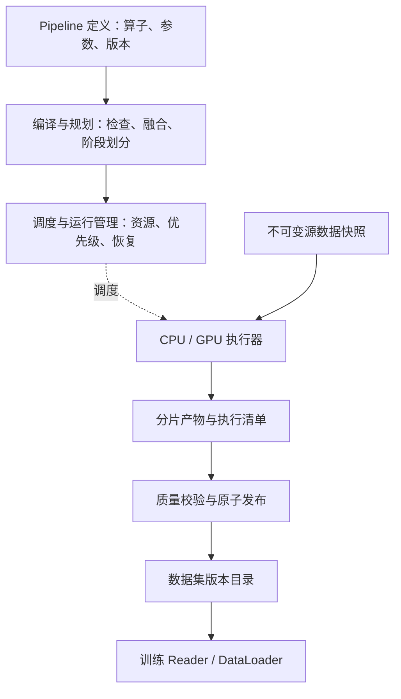

先把目标定义为：**一个面向离线训练数据生产的平台，支持多模态算子编排、CPU/GPU 混合执行、不可变版本发布、失败恢复，以及训练端可重复消费。**

建议先约定规模和验收目标，再决定执行框架、存储布局及调度策略。下面用一组**设计假设**展开，实际业务需要替换为真实数据。

### 1. 先明确规模与目标

| 维度 | 讨论假设 |
|---|---|
| 数据形态 | 文本、图片、音视频；一个原始文件可以产生多个训练样本 |
| 数据规模 | 存量 1 PB，每日新增 20 TB，支持历史重算 |
| 时效 | 每日增量在 8 小时内完成；历史重算低优先级运行 |
| 并发 | 数十条 Pipeline，存在共享算子、共享模型和多租户 |
| 资源 | CPU 约 2,000 核，GPU 配额上限 128 卡，按型号分池 |
| 存储 | 对象存储保存原始及产出数据，本地 SSD 用于缓存和临时计算 |
| 版本目标 | 训练只读取已发布快照；版本可追溯、可回滚 |
| 恢复目标 | 节点故障后从分区或检查点恢复，避免整条链路重跑 |

20 TB 在 8 小时内处理完，仅入口平均吞吐就需要：

\[
20\text{ TB}/8\text{ h}\approx0.7\text{ GB/s}
\]

这还没有包括解压、帧展开、Shuffle 和中间结果读写。**不能仅根据 TB 数量估算 GPU 数量**，还需要每个阶段的样本量、输入规格和单卡吞吐：

\[
N_{\mathrm{GPU},i}\ge
\frac{M_i}{q_i\times T\times\eta_i}
\]

其中 \(M_i\) 是进入该阶段的样本数，\(q_i\) 是单卡基准吞吐，\(\eta_i\) 是考虑数据等待、调度及重试后的折减系数。

还应提前确认：优先优化吞吐还是交付时限、历史重算能否被抢占，以及需要“谱系可重建”还是更严格的位级复现。

### 2. 平台分为控制面、执行面与数据面



控制面管理 DAG、运行、资源和版本；大体量数据放在对象存储或执行器缓存中。控制面传递分片描述与数据引用，避免承担图片、视频等数据的中转。

### 3. 算子首先要有明确语义

每个算子应声明以下契约：

| 契约 | 具体内容 |
|---|---|
| 输入输出 | Schema、字段含义、允许的空值、数据引用格式 |
| 基数 | Map 是一对一，FlatMap 是一对多，Filter 可以减少记录 |
| 分区与顺序 | 是否保持分区、要求排序、需要全局聚合或 Shuffle |
| 确定性 | 是否依赖随机数、模型、外部状态；种子和依赖如何固定 |
| 资源 | CPU、GPU、显存、内存、临时盘及并发要求 |
| 恢复 | 能否重试，是否有可恢复内部状态，是否产生外部副作用 |
| 版本 | 代码、镜像、模型、Tokenizer、参数和 Schema 版本 |

例如，`VideoDecode` 不能只返回一个图片列表，还要保留：

```text
asset_id、segment/frame 标识、时间位置、
派生 sample_id、数据引用、来源版本
```

编译器据此检查 Schema、插入 Shuffle、融合轻量算子。对于语义不透明或有副作用的 UDF，应保守处理重排与重试。

**流水线的编排粒度是分区、文件范围或数据块；避免为每一帧创建一个控制面任务。**

### 4. 阶段按资源与恢复边界划分

| 阶段 | 主要操作 | 资源特征 | 物化考虑 |
|---|---|---|---|
| 接入 | 清单生成、校验、元数据提取 | 网络、CPU | 固定源快照 |
| 预处理 | 解码、切片、规范化、便宜的过滤和精确去重 | CPU、内存 | 根据解码成本选择缓存 |
| 模型处理 | Caption、ASR、Embedding、质量判断 | GPU、显存 | 昂贵结果优先持久化 |
| 全局处理 | 语义去重、Join、统计、切分 | CPU、内存、Shuffle | 在全局交换边界检查点 |
| 训练产出 | Tokenize、Packing、混合、分片写出 | CPU、I/O，部分 GPU | 发布不可变训练快照 |

阶段划分同时考虑：能否流水执行、是否需要全局屏障、资源是否改变、失败后重算代价多大。

轻量 CPU 算子可以融合；昂贵 GPU 推理结果值得保留。无需把每个算子都落盘，也不能只在最终输出处设置恢复点。

### 5. CPU/GPU 调度需要同时约束吞吐和内存

**作业层**负责租户配额、优先级、交付期限和抢占。增量生产可以优先于历史重算。

**阶段层**维护 CPU worker 池和模型常驻的 GPU worker 池，并根据队列积压、实际吞吐、资源占用调整并发。GPU 批次还应按分辨率、视频长度或 token 数量分桶，减少 padding 和显存波动。

关键机制包括：

- 通过有界队列、预取窗口及在途字节数实现反压。
- GPU 变慢时，限制上游解码和预取，避免对象存储或内存无限积压。
- 根据模型与显存选择节点，而非只计算 GPU 数量。
- 对可复用数据进行节点本地缓存，兼顾数据局部性与资源可用性。
- 区分逻辑 GPU 份额与实际隔离能力，混部必须测量显存争用和性能干扰。

Ray 可以承担分布式执行和部分资源管理，但作业配额、数据版本与训练消费语义仍需要平台自身定义。

### 6. 存储、版本和恢复围绕 Manifest 设计

建议采用：

| 内容 | 保存位置 |
|---|---|
| 原始文件、昂贵中间结果、训练分片 | 对象存储 |
| 解码缓存、模型缓存、Shuffle 临时数据 | 本地 SSD / 执行器存储 |
| DAG、运行状态、租约、版本指针 | 事务型元数据库 |
| 大规模样本清单、谱系和质量结果 | 对象存储中的列式文件及 Manifest |

元数据库主要管理运行与分区级状态，避免为海量样本逐条维护任务状态。

一个数据集版本应记录源快照、算子依赖、模型及预处理版本、切分规则、产物清单和质量统计。复用缓存时，这些会影响结果的依赖都要参与缓存键。

发布采用如下流程：

```text
写入 attempt 独立的临时产物
→ 校验文件、记录数和内容摘要
→ 提交分区 Manifest
→ 汇总并完成数据质量检查
→ 原子发布数据集版本指针
```

执行允许重试。**通过幂等提交和原子发布保证逻辑产物唯一可见**，不要求计算过程只执行一次。

任务使用租约和 fencing token，阻止超时旧 worker 覆盖新结果。GPU 故障只重跑未提交分区；已提交且依赖未变的昂贵推理结果可以复用。未提交残留由延迟 GC 清理。

### 7. 训练消费也是平台契约的一部分

训练端读取固定版本 Manifest，按 rank/worker 分片，支持预取、缓存、Shuffle、混合采样和断点恢复。

训练检查点需要关联：

```text
数据集版本、采样策略、随机种子、
epoch/global step、分片分配与实际消费进度
```

**已预取的数据不等于已参与训练的数据。** 恢复位置需要与训练检查点的提交边界对应，否则可能跳过未训练样本。

如果训练发生弹性扩缩容，还要定义重新分片的规则：要求保持同一全局样本顺序，还是允许顺序变化但满足覆盖约束。不能默认两种语义都能自然获得。

最后，用统一指标验证整个设计：阶段吞吐和队列、在途字节、GPU 等待与执行时间、缓存命中、失败重算量、交付时间及单位有效样本成本。质量门禁同时检查 Schema、过滤原因、数据分布，以及训练/验证/测试之间的泄漏。

这套设计最值得深入展开的三个问题是：**算子契约如何支撑规划，Manifest 如何支撑发布与恢复，训练检查点如何与数据消费进度对齐。** 它们决定了平台是否能长期复用，而不仅是把若干处理脚本连接起来。
