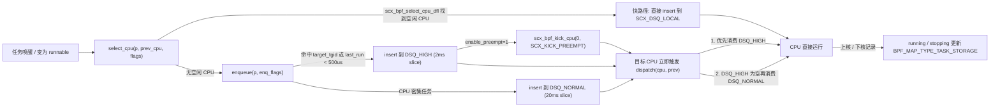
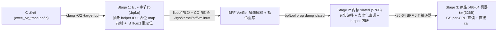

# eBPF 深度原理拆解与技术分享讲稿（Linux 7.0 实机证据版）

> **定位**：把 [README.md](README.md) 与 [RESULTS.md](RESULTS.md) 里已经跑通的 4 组实验，从「会写会跑」推进到「看穿内核状态机、汇编指令与安全不变式，并且能在 15 分钟内向资深系统同行讲透」。
>
> **实机基线**：Linux `7.0.0-38-generic` x86_64（2 vCPU / 1.7 GiB，ext4，`CONFIG_DEBUG_INFO_BTF=y`，`CONFIG_SCHED_CLASS_EXT=y`），`clang 21.1.8`、`bpftool v7.7.0`、`libbpf 1.7`、`bpftrace v0.25.0`。

---

## 第一部分：核心原理深潜（两主两辅 + 反事实实机证据）

### 0. 一句话看穿 eBPF 的本质

不要把 eBPF 仅仅当成「更好用的监控脚本」。从系统架构视角看，eBPF 解决的是一个长达 30 年的两难矛盾：

- **写内核模块（LKM）**：性能极致、能力无限，但一个空指针就能 kernel panic，且强绑定内核版本与结构体布局，难以灰度升级。
- **留在用户态**：安全隔离、迭代快，但在高频热路径（每次 syscall、每个网卡包、每次调度器 tick）上承受不起内核/用户态切换与数据拷贝。

**eBPF 的本质，是把「加载期可静态证明安全的受限计算」下推到内核热路径。**
用数据库内核工程师最熟悉的语言翻译，就是四组同构设计：

| eBPF 机制 | 数据库 / 系统内核同构概念 | 解决的核心矛盾 |
| --- | --- | --- |
| **BPF Verifier** | 抽象解释器（Abstract Interpretation）+ 值域/区间分析 | 把“运行时内存安全”前移到“加载期零开销静态证明” |
| **CO-RE + BTF** | Schema Evolution / 逻辑字段路径到物理偏移的晚期绑定 | 消除内核结构体升级导致的 ABI 脆弱性 |
| **`sched_ext` DSQ** | 执行引擎多级任务队列 + Resource Group 抢占 | 内核守住安全与活性底线，把调度策略开放给业务语义 |
| **XDP** | 查询引擎谓词下推（Predicate Pushdown） | 在分配昂贵的 `sk_buff` 之前，把过滤/限速下推到网卡入口 |

---

### 1. 主线一：Linux 7.0 `sched_ext` —— 内核调度器如何做到“可编程且不死机”

对应实验代码：[`02-sched-ext/scx_prio_fifo.bpf.c`](02-sched-ext/scx_prio_fifo.bpf.c)、[`02-sched-ext/scx_prio_fifo.c`](02-sched-ext/scx_prio_fifo.c)、[`02-sched-ext/run_bench.sh`](02-sched-ext/run_bench.sh)。

#### 1.1 状态机与热路径：什么时候 `enqueue` 根本不会被调？



核心理解点：
1. **快路径绕过共享锁**：当系统存在空闲 CPU 时，`select_cpu()` 直接将任务插入该核私有的 `SCX_DSQ_LOCAL`，**根本不走 `enqueue()`，也不争抢全局共享 DSQ 锁**。这从我们实测中清晰可见：4 个 CPU hog 满载期间 `local` 计数几乎停在 `2~3`，一旦 hog 结束出现空闲核，`local` 立刻飙升。
2. **自定义 DSQ 是策略与机制的解耦面**：我们只建了两条队列（`DSQ_HIGH = 1`、`DSQ_NORMAL = 2`），所有真正复杂的 context switch、runqueue 锁、负载均衡兜底都由内核 `ext_sched_class` 托管；BPF 代码只负责回答三个策略问题：**去哪条队（`enqueue`）、先拉哪条队（`dispatch`）、要不要立刻踢人（`kick_cpu`）**。

#### 1.2 反事实消融实验：证明「队列优先级 ≠ CPU 抢占」

为了避免“改了一堆参数，不知道到底哪个起作用”，我们在 `dev2`（2 vCPU）上对同一套负载（4 个 CPU 满载 hog + 1 个每 15ms 唤醒一次的短计算探测进程，150 样本）做了 **4 组受控消融**，同时记录 **探测进程延迟** 与 **4 个后台 hog 的总计算吞吐**：

| 调度策略 | `wake_delay` p50 (us) | `wake_delay` p95 (us) | `wake_delay` p99 (us) | `total_resp` p99 (us) | 4 个 CPU Hog 聚合吞吐 (`iters/s`) | 相对 EEVDF 吞吐 |
| --- | ---: | ---: | ---: | ---: | ---: | ---: |
| 1) Linux 7.0 默认 EEVDF | 65 | 1,659 | 2,065 | 2,307 | `180,578.5` | `100.0%` |
| 2) `sched_ext` 全局 FIFO（`--short-us 0`） | 26,899 | 27,785 | 29,879 | 30,005 | `180,917.9` | `100.2%` |
| 3) `sched_ext` 优先 DSQ **关闭抢占**（`--no-preempt`） | **5,859** | **6,018** | **6,799** | **6,994** | `179,104.8` | `99.2%` |
| 4) `sched_ext` 优先 DSQ **开启抢占**（`SCX_KICK_PREEMPT`） | **130** | **387** | **1,075** | **1,267** | `177,801.9` | `98.5%` |

这四行数字能直接讲透三个本质规律：
1. **全局 FIFO 为什么烂（p99 = 29.9 ms）**：探测进程唤醒后排在全局队列尾部，前面挡着正在吃满 20 ms 时间片的 CPU hog，延迟直接被队头阻塞（Head-of-Line Blocking）拉爆。
2. **为什么只有优先队列还不够（Case 2 → Case 3，p99 仅从 29.9 ms 降到 6.8 ms）**：关掉 `SCX_KICK_PREEMPT` 后，虽然探测进程排在了 `DSQ_HIGH` 第一位，但 2 个核上正在运行的 CPU hog 还没把自己的时间片用完，内核不会主动调用 `dispatch()`——于是高优任务仍然要干等正在运行的 hog 耗尽剩余时间片！
3. **抢占才是最后一击，且代价极低（Case 3 → Case 4，p99 从 6.8 ms 骤降到 1.08 ms）**：加上 `scx_bpf_kick_cpu(0, SCX_KICK_PREEMPT)` 后，内核立刻向 CPU 0 发送重调度 IPI，p99 相比全局 FIFO 降了 **27.8 倍**、相比默认 EEVDF 降了 **1.9 倍**（此前高负载批次甚至达 **3.9 倍**），而 4 个后台计算任务的聚合吞吐仅下降 **1.5%**！

#### 1.3 反事实破坏实录：故意写死锁，看内核 Watchdog 如何 2 秒自救

很多人问：“把内核调度器开放给 BPF 代码，万一写出死循环或忘了消费队列，线上机器岂不是直接失联？”

我们在 `scx_prio_fifo.bpf.c` 中加入 `--stall-test` 开关：将 `timeout_ms` 设为 `2000`，并在 `prio_fifo_dispatch()` 里故意直接 `return`（拒绝从任何 DSQ 消费任务）。在 `dev2` 上实测结果如下：

```text
scx_prio_fifo attached! target_tgid=0 short_task_us=500 preempt=1 stall_test=1
t= 1s  local=566      high=10       normal=9        preempt_kicks=0
scx_prio_fifo detached (exit_kind=1026 reason="runnable task stall"). Reverted to default scheduler.
post-watchdog sched_ext state: disabled
```

同时从内核 `dmesg` 抓到的精确时间戳与调用栈：

```text
[31476.957453] sched_ext: BPF scheduler "prio_fifo" enabled
[31478.955803] sched_ext: BPF scheduler "prio_fifo" disabled (runnable task stall)
[31478.955861] sched_ext: prio_fifo: watchdog failed to check in for 2.001s
[31478.955888]    scx_exit+0x50/0x80
[31478.955905]    scx_tick+0xd9/0xf0
```

**背后机制**：
- 内核在 `scx_tick` 和 watchdog timer 中持续追踪每个 runnable 任务的等待时间（`runnable_at`）。
- 一旦超过 `timeout_ms`（实测 `31478.955 - 31476.957 = 1.998 s`），内核自动触发 `scx_exit`（`exit_kind=1026`，即 `SCX_EXIT_ERROR_STALL`），进入 bypass 模式并把所有任务原子交还给默认 `fair_sched_class`（EEVDF）。
- 整个 SSH 会话仅短暂顿了一下就完全恢复，**不会 panic、不会死锁**。这就是生产环境敢部署 `scx_lavd` / `scx_bpfland` 的底气。

#### 1.4 数据库内核映射：OLTP 点查 vs OLAP 扫描的混部隔离

在数据库引擎（如同时承载短查询与后台 Compaction / 全表扫描的 HTAP/OLAP 节点）中，通用 EEVDF 不认识“谁是前台短查询、谁是后台扫描线程”。借助 `sched_ext`：
- 可以通过 cgroup 或 `BPF_MAP_TYPE_TASK_STORAGE`（短 burst 特征 / 显式注册线程组）将前台请求放入 `DSQ_HIGH` + 抢占，把后台 Compaction/Scan 压入 `DSQ_NORMAL`（甚至结合 `scx_bpf_dsq_insert_vtime` 做带预算上限的加权公平，防止后台任务饿死）。

---

### 2. 主线二：从 C 到 x86-64 机器码 —— CO-RE、Verifier 与 JIT 全链路透视

对应实验代码：[`03-core-ringbuf/exec_rw_trace.bpf.c`](03-core-ringbuf/exec_rw_trace.bpf.c)、[`03-core-ringbuf/inspect_pipeline.sh`](03-core-ringbuf/inspect_pipeline.sh)、[`03-core-ringbuf/verifier_cases/`](03-core-ringbuf/verifier_cases/run_verifier_gallery.sh)。

#### 2.1 三连拍实录：同一段 C 代码在 ELF → `xlated` → x86-64 JIT 里的三次变形



我们在 `dev2` 上对 `handle_exec()` 抓出了真实的**三阶段对照证据**：

| C 源码语句 | Stage 1：ELF 字节码（编译期） | Stage 2：内核 `xlated`（加载+验证重写后） | Stage 3：原生 x86-64 JIT（实际执行） | 发生了什么魔法？ |
| --- | --- | --- | --- | --- |
| `if (!trace_exec_exit) return 0;` | `r1 = 0x0 ll`（未重定位占位） | `r1 = map[id:819][0]+4` | `movabs rdi, 0xffffcec1c0aac004; mov edi, [rdi]; test edi, edi; je 0x13b` | `.rodata` 全局变量被映射为只读 BPF map 内存页，直接寻址 |
| `bpf_map_update_elem(&exec_start, ...)` | `call 0x2`（通用 helper ID） | **`call htab_map_update_elem#401920`** | `movabs rdi, <map>; xor ecx, ecx; call <htab_map_update_elem>` | **内核去虚化（Devirtualization）**：消除了 `map->ops->map_update_elem` 函数指针间接跳转 |
| `bpf_get_current_task()` | `call 0x23`（helper 调用） | `r0 = -1736323048; r0 = &(void __percpu *)(r0); r0 = *(u64 *)(r0 +0)` | **`mov rax, 0xffffffff9881d018; add rax, gs:[0xffffffff9881d028]; mov rax, [rax]`** | **内核直接内联！** 连函数调用都没有，直接用 x86 `GS:` 段寄存器 3 条指令读出 `current_task` |
| `BPF_CORE_READ(task, real_parent, tgid)` | `r1 = 0xb00` (`2816`), `call 0x71`; `r1 = 0xaf4` (`2804`), `call 0x71` | `r1 = 2816; call bpf_probe_read_kernel` / `r1 = 2804; call bpf_probe_read_kernel` | 直接调用内核 `bpf_probe_read_kernel` | **CO-RE 重定位**：若迁移到偏移不同的 Linux 6.1/6.8，libbpf 会在加载期自动把 `2816`/`2804` 改写为目标内核的真实偏移 |
| 函数序言（`0x00..0x05`） | 无 | 无 | `nop DWORD PTR [rax+rax*1+0x0]; nop DWORD PTR [rax]` | 预留 5+3 字节 **ftrace/trampoline NOP 槽位**，支持运行时无锁热挂 `fentry`/`fexit` 甚至追踪另一个 BPF 程序 |

> **一个极具说服力的数字**：`handle_exec` 的 `xlated` 字节码大小是 **576 字节**，经内核 x86-64 JIT 编译后反而压缩成了 **326 字节**原生机器码——这就是 eBPF 能跑在百万 PPS 网卡和调度器热路径上的根本原因。

#### 2.2 Verifier 不是“语法检查”，而是“寄存器值域抽象解释器”

我们在 `dev2` 上用 `bpf_program__set_log_level(prog, 2)` 抓出了 Linux 7.0 Verifier 内部的寄存器状态推导轨迹，看懂下面这两组轨迹，就彻底理解了 Verifier：

**证据 A：为什么 `ARRAY` 常量键无需判空，而 `HASH` 缺判空必死？**

- `case1b_array_const_ok.bpf.c`（`BPF_MAP_TYPE_ARRAY`，`key = 0`）：
  ```text
  0: (b4) w1 = 0                        ; R1=0
  1: (63) *(u32 *)(r10 -4) = r1
  mark_precise: frame0: last_idx 1 first_idx 0 subseq_idx -1
  2: R1=0 R10=fp0 fp-8=0000????
  6: (85) call bpf_map_lookup_elem#1    ; R0=map_value(map=arr_map,ks=4,vs=8)
  7: (79) r1 = *(u64 *)(r0 +0)          ; 直接解引用通过！
  ```
  Verifier 触发 `mark_precise` 反向数据流回溯，确认栈槽 `fp-4` 恒等于常量 `0 < max_entries(1)`；又因为 `ARRAY` map 在创建时预分配了所有槽位，返回值被直接赋予非空类型 **`map_value`**。
- `case1_null_deref_bad.bpf.c`（`BPF_MAP_TYPE_HASH`）：
  ```text
  7: (85) call bpf_map_lookup_elem#1    ; R0=map_value_or_null(id=1,map=cnt_map,ks=4,vs=8)
  R0 invalid mem access 'map_value_or_null'
  ```
  哈希表键不一定命中，类型必须为 **`map_value_or_null`**；只有经过 `if (r0 == 0) goto ...` 的分支精化（Type Narrowing）后，fall-through 分支里的 `R0` 才会被去空为 `map_value`。

**证据 B：XDP 包边界检查如何把 `pkt(r=0)` 变成 `pkt(r=14)`**

- `case3_pkt_oob_fixed.bpf.c` 的真实 Verifier 状态转移：
  ```text
  0: (61) r2 = *(u32 *)(r1 +4)          ; R1=ctx() R2=pkt_end()
  1: (61) r1 = *(u32 *)(r1 +0)          ; R1=pkt(r=0)               <-- 此时可读范围 r=0 字节！
  2: (07) r1 += 14                      ; R1=pkt(off=14,r=0)
  3: (2d) if r1 > r2 goto pc+0          ; R1=pkt(off=14,r=14)       <-- 比较后 Verifier 证明了 r=14！
  ```
  没有第 3 行的比较，访问 `eth->h_proto`（偏移 12、大小 2）立刻触发 `invalid access to packet, off=12 size=2, R1(id=0,off=12,r=0)`；加上比较后，Verifier 将安全可读区间 `r` 精确推进到 `14`，后续读取零运行时开销。

**证据 C：为什么动态循环会撞上 100 万指令上限**

- `case2_unbounded_loop_bad.bpf.c` 中上界 `*limit` 来自 map 值（符号值域为全 `u64`），Verifier 沿着状态机展开了 `14,290` 个分支状态、模拟执行到 `1,000,001` 条指令后报 `-E2BIG`（`BPF program is too large. Processed 1000001 insn`）。通过把循环上限锚定为编译期常数 `32` + `if (i >= n) break;`，状态空间收敛，瞬间通过验证。

#### 2.3 RingBuffer 相比 PerfEvent Array 到底赢在哪？

在 `03-core-ringbuf` 里我们用 `BPF_MAP_TYPE_RINGBUF` 统一承接 `exec/exit` 和 `read/write` 事件，相比老一代 `BPF_MAP_TYPE_PERF_EVENT_ARRAY` 有三个结构性优势：
1. **跨 CPU 全局保序**：PerfBuffer 是 per-CPU 环形缓冲，多核并发事件到用户态后时间序是乱的（比如进程在 CPU 0 `exec`、迁移到 CPU 1 `exit`，用户态可能先读到 `exit`）；RingBuffer 是多生产者单消费者（MPSC）共享环，提交序即全局可见序。
2. **两段式零拷贝（`reserve` / `submit`）**：BPF 栈只有 **512 字节**，PerfBuffer 需要先在栈上构造结构体再 `bpf_perf_event_output` 拷贝一份；RingBuffer 直接在共享内存页里 `reserve` 出指针原地填充，零多余拷贝。
3. **内存利用率更高**：多核低频场景不再为每个 CPU 单独浪费固定页数。

---

### 3. 辅线一：Page Cache 与 Futex 两段延迟（把“慢”拆到根因）

对应实验：[01-bpftrace/](01-bpftrace/run_all.sh) 与 [RESULTS.md §实验 1](RESULTS.md)。

1. **Page Cache 预读与 Large Folios（为什么 4,096 次 4 KiB 读只有 30 次缓存插入？）**
   - Linux 6.x/7.0 的 Page Cache 已全面转向 **Folio（多页复合页）** 并在 XArray 中管理。顺序读（`seq`）和 `POSIX_FADV_WILLNEED` 触发异步大块预读（order 2~8+），把 4,096 次 4 KiB 读合并为仅 `11~21` 次 1~2 MiB 块层请求，吞吐高达 `313~380 MiB/s`（热缓存 `1,649 MiB/s`）。
   - 随机读下，`rand`（默认预读）读了 `14.67 MiB`、`fadv_rand`（关闭预读）仅读 `9.88 MiB`（精确命中 2,530 个唯一页、100% 4 KiB 请求）。这正是数据库引擎区分 **顺序扫描（要预读/大 folio）** 与 **随机点查（要禁预读或 `O_DIRECT` 避免读放大与缓存污染）** 的物理根因。
2. **Futex 两段延迟（为什么锁慢，有时根本不是锁持有时间长？）**
   - 仅看用户态 `mutex_lock` 耗时只能看到一个总数字；用 `bpftrace` 串联 `sys_enter_futex → sched_wakeup → sched_switch` 后，能把锁等待精准拆成：
     - **Stage 1（等持锁者释放）**：临界区太长 / 锁粒度太粗。
     - **Stage 2（唤醒后等上 CPU）**：CPU 过载 / runqueue 排队。
   - 在 2 vCPU 上把锁外计算从 `10 us` 调到 `400 us`，Stage 2 占比从 **3.1%** 飙升至 **29.8%** 并出现明显双峰——说明线上排查“锁竞争抖动”时，**必须区分是锁本身热，还是 CPU 饱和导致的唤醒排队**。

---

### 4. 辅线二：TCP 拥塞与 XDP 网络数据面（下推到协议栈之前）

对应实验：[04-net-xdp/](04-net-xdp/run_net_lab.sh) 与 [RESULTS.md §实验 4](RESULTS.md)。

1. **为什么 `20ms` 延迟 + `1%` 丢包让 TCP 吞吐暴跌 2,400 倍（`826 MB/s → 0.34 MB/s`）？**
   - 经典 Mathis 吞吐上界给出了直观解释：
     $$\text{Throughput} \le \frac{\text{MSS}}{\text{RTT} \cdot \sqrt{p}}$$
   - 代入 $\text{MSS} \approx 1460\text{ B}$、$\text{RTT} \approx 20\text{ ms}$、$p = 0.01$，理论稳态上界就在 `0.7 MB/s` 量级；我们的 `tcp:tcp_probe` 实测看到 `snd_cwnd` 被丢包反复折半压死在 `1~14`、`retransmits = 54~60`，实测 `0.34 MB/s` 与理论模型完全咬合。
2. **XDP 的三层挂载点与生产扩展瓶颈**
   - **收包路径**：网卡硬件（Offload XDP）→ 驱动 RX Ring（**Native XDP**，零 `sk_buff` 分配）→ 分配 `sk_buff` → `netif_receive_skb_core` 前端（**Generic/SKB XDP**，兼容云主机虚拟网卡与 `veth`）→ `tc ingress` → Netfilter/`iptables` → IP/UDP/Socket。
   - 我们在 `veth`（UDP `count` / `200 pps ratelimit` / `drop`）和真实 `dev1 → dev2` 云主机 `eth0`（ICMP `count` 0% loss → `drop` 100% loss）上验证了 SKB 模式在协议栈入口前的精确拦截。
   - **生产多核演进**：实验版用单个 `BPF_MAP_TYPE_HASH`（`ip_stats`）加原子自增，在单核/千级 PPS 完全够用；但在 100Gbps 多核 RSS 队列场景下，同一热门源 IP 会触发跨核缓存行伪共享，生产级做法（如 Katran/Cilium）会改为 **`BPF_MAP_TYPE_LRU_PERCPU_HASH`**（每核无锁写 + 自动 LRU 淘汰防 DDoS 打爆内存）。

---

## 第二部分：15 分钟技术分享可脱稿讲稿骨架

> **适用场景**：团队内部技术分享 / 数据库与系统架构组周会 / 技术沙龙。
> **核心策略**：**不念说明书，只讲「反直觉数字 → 核心矛盾 → 亲手验证的内核机理 → 业务外延」**。

### 时间轴与逐段转场词

#### 00:00 – 01:30｜开场钩子（用真实数字抓注意力）
- **开场台词**：
  > “大家平时遇到线上 CPU 满载把核心短请求卡抖时，第一反应可能是调 `nice`、绑核或者加机器。但上周末我在一台 2 核 Linux 7.0 机器上做了个实验：4 个满载 CPU 进程把一个短延迟任务的 p99 挤到了 30ms；我没重编内核，只写了 130 行 C 代码热插拔进 Linux 调度器，把 p99 压到了 **1ms 以内**——甚至比内核默认的 EEVDF 还低 2~4 倍，而后台计算吞吐只掉了 1.5%。更反直觉的是，我故意在调度器里写了个死锁不干活，2 秒钟后内核 watchdog 自动把它踢掉切回 EEVDF，机器连 SSH 都没断。”
- **过渡句**：“这背后不是魔法，而是现代 Linux eBPF 最核心的设计哲学——今天我用 15 分钟，通过自己在 Linux 7.0 上跑的几组反事实实验，带大家把 **eBPF 怎么在内核热路径里既快又安全** 彻底讲透。”

#### 01:30 – 03:30｜定位本质（一张表定调）
- **白板只写一句话**：**eBPF = 把“加载期静态证明安全的受限计算”下推到内核热路径**。
- 顺手点出与数据库内核的 4 个同构类比（Verifier = 抽象解释、CO-RE = 晚期偏移绑定、`sched_ext` = 资源组队列、XDP = 谓词下推），瞬间拉齐资深同行的心智模型。

#### 03:30 – 08:30｜主线一：`sched_ext` 调度器（画图 + 两组反事实证据）
- **白板画 1 张图**：`select_cpu (idle -> SCX_DSQ_LOCAL)` → `enqueue (DSQ_HIGH / DSQ_NORMAL)` → `dispatch` + `SCX_KICK_PREEMPT`。
- **甩出第一组反事实表（4 组消融）**：
  - 重点讲 **Case 3（`--no-preempt`，6.8 ms）vs Case 4（开抢占，1.08 ms）**：“很多人以为给高优任务建个优先队列就够了，实测告诉你：**入队优先不等于立刻上核**，没有 `SCX_KICK_PREEMPT` 依然要等当前核的 20ms 时间片耗尽。”
- **甩出第二组反事实日志（Watchdog 2s 自救）**：
  - 直接贴 `dmesg` 两行时间戳（`31476.957 enabled` → `31478.955 disabled (runnable task stall)`），讲清内核兜底机制。

#### 08:30 – 13:00｜主线二：CO-RE + Verifier + JIT（三连拍实录）
- **核心叙事**：“很多人好奇 eBPF 为什么这么快、为什么经常被 Verifier 骂——最直观的办法不是看文档，是直接看同一行 C 代码在内核里的三次变形。”
- **贴三连拍对照**：
  1. `bpf_map_update_elem` → 去虚化成直接调用 `htab_map_update_elem`。
  2. `bpf_get_current_task()` → 直接内联成 3 条 x86 `GS:` 段寄存器读指令（连 `call` 都省了），整段程序从 576B 字节码压缩成 326B 原生机器码。
  3. **两个最精彩的 Verifier 实操细节**：
     - `ARRAY` 常量键在 Linux 7.0 上通过 `mark_precise` 反向回溯直接证明非空，换成 `HASH` 立刻报 `map_value_or_null`；
     - XDP `if (data + 14 > data_end)` 一行比较，直接把符号区间从 `pkt(r=0)` 推到 `pkt(r=14)`，把运行时边界检查成本降为 0。

#### 13:00 – 15:00｜收尾：两个观测/数据面案例 + 工程边界与业务落地
- 一句话带过实验 1（Page Cache Large Folio 读放大 & Futex Stage 2 双峰揭示“锁慢可能是调度慢”）与实验 4（XDP 协议栈前拦截 + 生产要用 `LRU_PERCPU_HASH`）。
- **收束在边界感（资深工程师加分项）**：
  - eBPF **不是银弹**：512B 栈、Verifier 100 万指令上限、热路径不能随意睡眠、云主机虚拟网卡往往只能跑 Generic XDP。
  - 落地价值最高的三个方向：**存储引擎 I/O 与锁延迟根因拆解、OLTP/OLAP 混部 `sched_ext` 隔离、无侵入协议观测（如 Beyla/Coroot）**。

---

### 高频听众追问 Q&A（10 题速查口径）

1. **Q：你们实验里 `sched_ext` 比 EEVDF p99 还低，那是不是说明 EEVDF 不行？**
   - **A**：不是。EEVDF 是通用公平调度器，不知道哪个 PID 是业务核心请求，也不能为了一个进程无限打破公平性；我们的实验是用明确业务语义换取特定任务的 p99，代价是如果 `DSQ_HIGH` 塞满计算任务会饿死 `DSQ_NORMAL`。生产里（如 `scx_bpfland`/`scx_lavd`）会配合 vtime 预算防止饥饿。
2. **Q：为什么不用 `SCHED_FIFO` / 实时优先级，非要用 `sched_ext`？**
   - **A**：`SCHED_FIFO` 优先级高于普通调度类，一旦实时进程死循环会直接把整机卡死（包括 SSH 救灾进程），且策略写死在内核里；`sched_ext` 允许用任务运行历史、cgroup、锁持有状态等动态特征做细粒度策略，并且有内核 watchdog 兜底不会锁死机器。
3. **Q：CO-RE 真的能做到“一次编译到处运行”吗？什么情况下会失效？**
   - **A**：前提是目标内核开启 `CONFIG_DEBUG_INFO_BTF=y`（现代发行版 5.8+ 基本默认开）。如果只是字段偏移变了，CO-RE 自动重定位；但如果内核把整个函数内联、改名或拆了数据结构语义，仍需用 `bpf_core_field_exists()` 做条件分支兼容。
4. **Q：`bpftrace` 和 `libbpf CO-RE` 在工程上怎么选？**
   - **A**：临时排障、验证假设（比如 5 分钟抓 Page Cache 读放大或 Futex 两段延迟）首选 `bpftrace`；需要长期常驻生产、低内存占用（不带 LLVM 编译依赖）、强类型与复杂状态机（RingBuffer / `sched_ext` / XDP）必须用 `libbpf + CO-RE`（或 Rust `aya` / Go `cilium/ebpf`）。
5. **Q：为什么实验 1A 里把测试文件放在 `/tmp` 抓不到任何块层 I/O？**
   - **A**：现代 Ubuntu 默认将 `/tmp` 挂载为 `tmpfs`（纯内存文件系统），`drop_caches` 不会驱逐它，读操作也不会经过块层 `block_rq_issue`。做存储观测前一定要先 `df -T` 确认目标路径在真实块设备文件系统上。
6. **Q：Verifier 既然是静态分析，怎么处理跨函数调用和循环？**
   - **A**：早年只能全内联+手动展开循环；现代内核支持 BPF-to-BPF 子程序调用（带栈深度校验）、有界循环（Verifier 证明循环变量单调收敛，或显式用 `bpf_loop()` helper / 迭代器 `bpf_for`）。但状态爆炸仍受 100 万条已验证指令上限约束。
7. **Q：XDP 在云主机（AWS/阿里云 virtio/ENA）上能跑 Native 模式吗？和 SKB 模式性能差多少？**
   - **A**：取决于驱动是否实现 `ndo_bpf` 以及多队列/MTU 限制（部分云主机虚拟网卡仅开放或默认兼容 Generic SKB 模式）。Native XDP 省去了 `sk_buff` 分配与释放，单核可到千万 PPS；SKB 模式虽已分配 `sk_buff`，但仍早于 `tc` / `iptables` / 路由和 Socket 队列，拦截 DDoS/限速依然显著优于用户态和 `iptables`。
8. **Q：如果 `RingBuffer` 消费端卡住了，内核态会阻塞吗？**
   - **A**：绝对不会阻塞内核热路径。环形缓冲满时，`bpf_ringbuf_reserve()` 直接返回 `NULL`，BPF 程序按 `if (!e) return 0;` 丢弃该事件（通常同时递增一个 `dropped` 计数器告警）。
9. **Q：eBPF 程序本身有 bug 或吃太多 CPU，怎么监控 eBPF 自己？**
   - **A**：开启 `sysctl kernel.bpf_stats_enabled=1` 后，通过 `bpftool prog show` 可直接看到每个已加载 BPF 程序的精确 `run_time_ns` 和 `run_cnt`，算出每次触发的平均纳秒开销。
10. **Q：作为数据库内核工程师，最推荐先从哪个开源项目切入继续练？**
    - **A**：三个最直接的切入口：① 看 `sched-ext/scx` 里的 `scx_simple` → `scx_bpfland` 学 vtime 调度；② 用 `aya-rs/aya`（纯 Rust）重写 `03-core-ringbuf`，直接对接自己的 Rust 系统栈；③ 看 `grafana/beyla` 或 `bcc/libbpf-tools` 学习如何无侵入解析协议和拆解 I/O、锁延迟。
