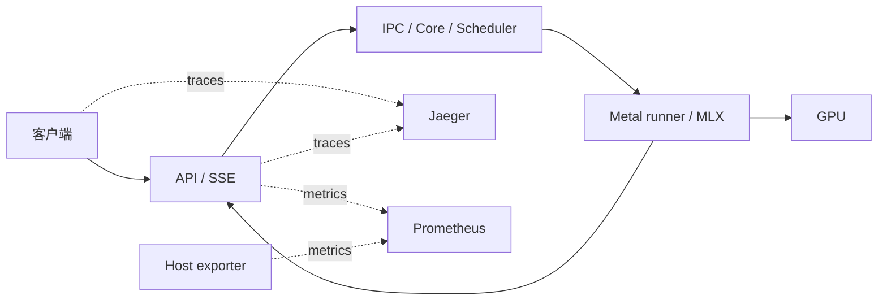

# 请求链路与观测契约

采用 Prometheus 保存聚合趋势，OTel 保存单请求关联，系统采样记录同窗口背景。平台必须先
证明数据完整和开销可控，再解释 prefill/TTFT 的差异。

当前实现 M1/M2 与限定 UniProcExecutor 的 M3，真实 B=1/B=4 成功链路已验证；
错误/取消仍只有合成测试。M4 已执行暖缓存详细埋点开关的小样本交错对照，
尚不能隔离整机背景波动或说明全平台成本。
短请求已观测到详细 tracing 的 E2E 成本，诊断模式不作为低扰动性能基线。Python 函数
耗时不能作为 GPU duration，`--collect-detailed-traces all` 也不能替代未接入的 Metal 埋点。

## 已实现的 host 执行边界

| 事件 / span | 测量边界 | 说明 |
| --- | --- | --- |
| api.chat.render | 模板/分词调用前后 | 与 API 总请求分开 |
| api.engine.ingress / api.core.enqueue | API enqueue / core receive 两端事件 | 包括本地队列和 IPC，不称纯线速传输 |
| request queued / scheduled | core 真实事件时间 | 排队与调度 CPU 时间分开 |
| scheduler.schedule / scheduler.update_output | 原方法入口到返回 | 共享 batch 的子 span，带真实 scheduled token 数 |
| runner.prepare_submit.host | host 准备到异步提交返回 | 包含 graph / async_submit 子 span，不表示 GPU 已完成 |
| mlx.sample_materialize.host / mlx.deferred.resolve.host | 实际采样/结果物化边界 | deferred 归到 pending 批次，不额外同步 |
| core.output.ready / api.output.received | core 更新返回 / API 输出队列观察点 | trace headers 携带 core/API batch ID；不是 socket 时间戳 |
| request.finished / kv.released | 终止与释放引用事件 | 释放引用不等于释放物理内存 |

vLLM 0.33.0 的 Request 带 trace headers，但 NewRequestData 没有相同字段。
本模块通过 sitecustomize 的按模块 import hook 在本进程建立 request→SchedulerOutput
join，利用 UniProcExecutor 传递的真实对象身份覆盖 runner；不支持把这套 join 假装跨
worker 进程使用。EngineCoreOutput 的传播字典复制后追加诊断 batch ID，不修改 token、
采样配置或请求原 carrier。API 输出 batch 也只记录一次共享处理。
预检记录上游文件 SHA256/签名，实际导入核对未变化；不复制上游源码、不修改 site-packages。
埋点 provider 使用独立系统随机源生成 trace/span ID，避免模型初始化的全局 Python seed
重置造成跨运行 ID 碰撞；不读取或推进模型的 Python PRNG。回归测试覆盖重复 seed 下的
ID 独立性，真实验收核对所有 batch span 的 run ID 与进程实例。

每请求一个 trace，batch 为共享执行单元，通过 OTel Links 关联多个请求；不能给同一共享
GPU 工作生成多份时长，或平均分摊后称为每请求真实耗时。request ID、trace ID、iteration
ID 放入 spans 或有界明细，不作为 Prometheus labels。

埋点记录 monotonic ns、epoch ns、pid、进程实例 ID 与模型 run ID。span 使用 epoch，阶段
持续时间用 monotonic；先核验进程之间的时钟域，再比较跨进程边界。保留原始时间，不依赖
UI 自动修正重建关键路径。原生 queued/scheduled/first output 时间用于对齐 vLLM 指标；
first output 是原生 EngineCoreOutputs 创建时间，core.output.ready 是 wrapper 观察到返回的时间。
async pipeline 可能在首个输出前启动下一轮；分析按时间窗口裁剪并合并相同阶段的区间，
不同层级的父子 span 不能直接相加。字典容量有界，诊断关联缺失直接失败；未采样请求不注册。
SDK 在后台导出，查询缺少所需 span 会让验收失败；不承诺在丢 span 后提供完整链路。

## 首输出窗口的 compact 模式

默认传播 `llmobs=compact`；显式 full/off 保留其选择。compact 只为首输出前进入执行队列的
batch 建共享 root。阶段用 monotonic/thread CPU 采样并暂存，至请求终止后写成事件；
请求生命周期仍持续到结束。后续 decode/API 输出不创建逐轮 span，完整路径调查使用 full。
mixed-mode batch 只要有 full 请求就按 full 记录一次，不能声称其中 compact 请求独立承担
某一比例的共享成本。无记录的热路径直接调用原函数，不引入 GPU eval/synchronize。

native async_eval 与外围输出收集分开计时，记录线程 CPU、进程 fault/context-switch 增量，
并读取 MLX active/peak/limit。CPU 时间不等于整个进程 CPU，wall−CPU 也不是纯 GPU 时间。
进程 fault counters 不提供 GPU 页故障归因。只在 idle 记录之间重算 epoch−monotonic offset，
API phase 使用入口时的局部 offset 配对起止；请求内发生 sleep 或时钟跳变时，对照必须失败。

固定 KV 对照关闭 prefix cache，使用相同 prompt IDs、greedy 输出 IDs 和实际 Core KV blocks，
热身后按模式排列交错测量。模式对照在同一模型进程内；队列策略对照使用相同容量的独立
重启并恢复复测。每条只生成一次，拒绝不完整的 latency histogram 窗口与 wall/monotonic
明显分离。不能删除异常样本后继续把原轮次当通过，失败归档必须保留并另起对照。

## 验收顺序

1. M1：native 配置可读、三进程正常、Prometheus 的监控 targets up、OTLP 合成 trace 可查询；
   模型 endpoint 不可用时独立报告，不用合成成功冒充模型接入。
2. M2：真实服务启动后分别验收自然结束、服务错误与取消；client/API/llm_request 在同一 trace，
   SSE span 覆盖最终 body，内容与 token/usage 归档一致。
3. M3：B=1 / B=4 的 request/iteration/batch 关联正确；没有串 trace、共享耗时重复、
   未解析的 pending/deferred 步骤；GPU duration 未测时明确留空。
4. M4：同 checkpoint、输入 IDs、输出设置、cache/KV 和系统条件比较观测开关；记录
   CPU/RSS/分页与运行间波动，导出器故障不阻塞生成，不在请求路径同步重试。
5. M5：先定位 API / IPC / scheduler / host submit / resolve / receive 中实际变长的段，
   再决定是否需要独立 Metal/CPU trace。系统换页相关性不直接升级为模型分页根因。
