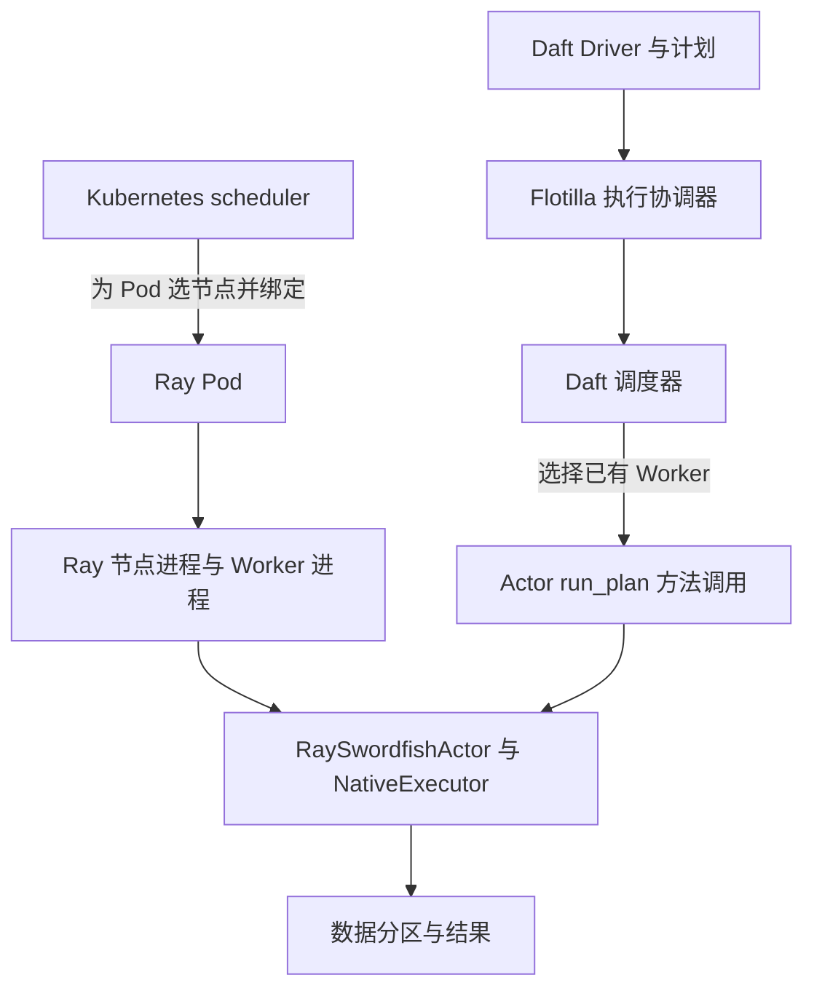

# 第 2 讲：Daft、Ray、Kubernetes 分别调度什么？

日期：2026-11-05（北京时间）。用时：约 60 分钟。

今天要能解释这件事：**Daft 可以把许多数据任务交给一个已经运行的 Ray Actor；Kubernetes 给承载 Ray 的 Pod 选择节点。增加数据任务数量，不会必然增加 Actor 或 Pod 数量。**

前一讲讨论资源形状为什么导致等待。今天继续追问：请求到底在哪一层等待，由谁决定下一步？

## 0–5 分钟：从一次离线推理开始

假设需要读取一批文本，清洗后分批调用模型，再写回结果。系统中会出现这些对象：

| 对象 | 中文含义与作用 | 与其他对象的关系 |
| --- | --- | --- |
| Daft plan | 数据处理计划，描述算子和数据依赖 | 分布式计划继续产生可执行的局部计划与任务 |
| Daft task | Daft 调度器安排的一份执行工作 | 可携带局部物理计划、输入与资源需求 |
| Ray Task | 一次 Ray 远程函数调用 | 可在复用的 Ray Worker 进程中运行 |
| Ray Actor | 在工作进程中承载对象实例，供后续远程调用 | 同一个 Actor 可以执行多次方法调用 |
| Daft Worker | Daft 眼中的执行器与容量 | 本讲的 Ray 后端通过 Ray Actor 承载 |
| Ray Worker | Ray 运行用户代码的工作进程 | “Worker”在这里与上一行不是同一个抽象 |
| Kubernetes Pod | 一组容器的运行与调度单元 | 在 Kubernetes 部署下，承载 Ray 节点进程与工作进程 |

**Daft task 与 Ray Task 不是同一个类型。** 在今天核验的执行路径中，一份 Daft task 通过一次 Actor 的 `run_plan` 方法调用送去执行；它没有因此变成一个新 Actor。

Ray 也能直接运行在机器上。下面的 Kubernetes 部分是部署在 Kubernetes 上时的额外一层；本机 raylab 不需要 Pod。

## 5–25 分钟：沿四个源码入口读调用链

本讲基于本地工作树源码；本次核验的 HEAD 如下，不代表上游最新版本，也不证明已加载的二进制由这些提交构建。

| 仓库 | 本地 HEAD |
| --- | --- |
| [Daft](https://github.com/Eventual-Inc/Daft) | `1e7eef899f69f55bf0267edd5a5f075dbad57697` |
| [ray](https://github.com/ray-project/ray) | `d3febe7397071c9993aafc1b33a0d5059ea2cc4c` |
| [kubernetes](https://github.com/kubernetes/kubernetes) | `d5cbb79be9160faa3a7d7323e3294c3781c16ae7` |

### 入口一：Daft 把计划交给执行协调器，约 4 分钟

读 [RayRunner.run_iter](https://github.com/Eventual-Inc/Daft/blob/1e7eef899f69f55bf0267edd5a5f075dbad57697/daft/runners/ray_runner.py#L574)，重点定位两个调用：

```python
DistributedPhysicalPlan.from_logical_plan_builder(...)
self.flotilla_plan_runner.stream_plan(...)
```

前一个把逻辑计划转成分布式物理计划；后一个进入分布式执行。逻辑计划描述“算什么”，物理计划进一步描述“怎样组织执行”。本讲暂不展开优化规则。

继续读 [FlotillaRunner.stream_plan](https://github.com/Eventual-Inc/Daft/blob/1e7eef899f69f55bf0267edd5a5f075dbad57697/daft/runners/flotilla.py#L782)：它通过 `self.runner.run_plan.remote(...)` 提交计划，再调用 `get_next_partition.remote(...)` 取结果。

这里的 `RemoteFlotillaRunner` 是 Daft 放进 Ray Actor 中的执行协调器。协调器和执行数据工作的 Actor 有不同职责，不能把它们都叫作“一个 Worker”后就忽略区别。

### 入口二：Daft 选择哪个已有 Worker 执行，约 6 分钟

读 [DefaultScheduler.schedule_tasks](https://github.com/Eventual-Inc/Daft/blob/1e7eef899f69f55bf0267edd5a5f075dbad57697/src/daft-distributed/src/scheduling/scheduler/default.rs#L121)。依次回答：

1. 待执行任务放在 `pending_tasks`，为什么没有容量的任务会重新放回这里？
2. `try_schedule_task` 怎样区分 `Spread` 与 `WorkerAffinity`？
3. 选中 Worker 后，为什么立刻把这份任务加入其 `active_task_details`？

第三点影响同一轮调度：选中一个任务后就更新本轮容量账目，后面的任务不能继续把那份容量当成空闲。

亲和性表示“倾向于或必须到某个位置执行”。读 [try_schedule_worker_affinity_task](https://github.com/Eventual-Inc/Daft/blob/1e7eef899f69f55bf0267edd5a5f075dbad57697/src/daft-distributed/src/scheduling/scheduler/default.rs#L60)：

- 指定 Worker 有容量，选择它。
- 指定 Worker 无法接收，且 `soft=true`，回退到 Spread。
- `soft=false`，保持未调度，即使别处存在空闲容量。

Spread 在这份代码中先筛可接收任务的 Worker，再按可用 CPU 与 GPU 数量之和的整数值选一个最大者；并列时不应假定稳定选择某个 Worker。不要仅凭名称就把它解释成轮询。

选读 [WorkerSnapshot.can_schedule_task](https://github.com/Eventual-Inc/Daft/blob/1e7eef899f69f55bf0267edd5a5f075dbad57697/src/daft-distributed/src/scheduling/scheduler/mod.rs#L240)：当前实现比较 CPU 可用量；GPU 分支检查“任务需要 GPU 且可用 GPU 为零”，内存检查仍有 TODO。不能把这个函数概括成已经完整验证 CPU、GPU 数量、显存与内存的通用资源判定器。本讲后面的容量推演只使用 CPU。

这讲精读 `DefaultScheduler`；同目录也存在其他调度策略，不能把某一个实现的细节直接推广到所有 Daft 执行模式。

### 入口三：跨过 Rust/Python 边界，调用 Actor，约 7 分钟

先看这条调用关系，再只精读末端的 Python 代码：

```text
Daft Scheduler 选出 (task, worker_id)
  → Dispatcher.dispatch_tasks
  → RayWorkerManager.submit_tasks_to_workers
  → RaySwordfishWorker.submit_tasks                 [Rust]
  → RaySwordfishActorHandle.submit_task              [Python]
  → actor_handle.run_plan.options(name=...).remote(...)
  → RaySwordfishActor.run_plan
  → NativeExecutor.run                              [执行局部计划]
```

中间几层的源码路标：

- [Dispatcher.dispatch_tasks](https://github.com/Eventual-Inc/Daft/blob/1e7eef899f69f55bf0267edd5a5f075dbad57697/src/daft-distributed/src/scheduling/dispatcher.rs#L36)：按 Worker 汇总任务，并取得结果句柄。
- [RayWorkerManager.submit_tasks_to_workers](https://github.com/Eventual-Inc/Daft/blob/1e7eef899f69f55bf0267edd5a5f075dbad57697/src/daft-distributed/src/python/ray/worker_manager.rs#L114)：找到对应 Worker 并提交。
- [RaySwordfishWorker.submit_tasks](https://github.com/Eventual-Inc/Daft/blob/1e7eef899f69f55bf0267edd5a5f075dbad57697/src/daft-distributed/src/python/ray/worker.rs#L83)：通过 Python 绑定调用 `submit_task`。

精读 [RaySwordfishActorHandle.submit_task](https://github.com/Eventual-Inc/Daft/blob/1e7eef899f69f55bf0267edd5a5f075dbad57697/daft/runners/flotilla.py#L390) 与 [RaySwordfishActor.run_plan](https://github.com/Eventual-Inc/Daft/blob/1e7eef899f69f55bf0267edd5a5f075dbad57697/daft/runners/flotilla.py#L212)。注意 `run_plan` 接收的是局部计划和输入，内部调用已经存在的 `self.native_executor.run(...)`。

再回看 [start_ray_workers](https://github.com/Eventual-Inc/Daft/blob/1e7eef899f69f55bf0267edd5a5f075dbad57697/daft/runners/flotilla.py#L430)：它遍历 `ray.nodes()`，为符合条件且尚未有 Worker 的节点创建 Actor。这里用 `NodeAffinitySchedulingStrategy(node_id=..., soft=False)` 指定 Ray 节点。

这与上一节的 `WorkerAffinity` 分属两层：前者决定 **Ray Actor 去哪个 Ray 节点**；后者决定 **Daft task 去哪个已有 Daft Worker**。

#### 一个需要逐字读的细节

`start_ray_workers` 中的实际结构是：

```python
RaySwordfishActor.options(**swordfish_options).remote(
    num_cpus=int(node["Resources"]["CPU"]),
    num_gpus=int(node["Resources"].get("GPU", 0)),
    ...,
)
```

这两个 `num_*` 是传给 `RaySwordfishActor.__init__` 的参数。该构造函数用 `num_cpus` 配置本地计算线程数，并在相应条件下设置 GPU 可见性环境变量。

把它与下面的写法对照：

```python
# 对照示意，不是建议修改现有 Daft 实现。
SomeActor.options(num_cpus=4).remote(...)
```

后者才在 Ray Actor options 中声明 CPU 请求。不能从前者的参数名字推出“Ray 已给这个 Actor 独占预留整台节点的 CPU/GPU”；Ray 的默认资源规则与 Daft 内部容量账目需要分别看。

如需追到 Ray 边界，选读 [ActorClass._remote](https://github.com/ray-project/ray/blob/d3febe7397071c9993aafc1b33a0d5059ea2cc4c/python/ray/actor.py#L1883)：`resources_from_ray_options(actor_options)` 生成资源请求，构造参数另行整理为 `creation_args`，二者分别传入 `core_worker.create_actor`。

### 入口四：Kubernetes 选择 Pod 所在节点，约 3 分钟

复读 [Scheduler.scheduleOnePod](https://github.com/kubernetes/kubernetes/blob/d5cbb79be9160faa3a7d7323e3294c3781c16ae7/pkg/scheduler/schedule_one.go#L92)：成功完成调度阶段后进入绑定阶段，把 Pod 与节点关联。后续还要有容器和应用启动过程。

这一层处理 Pod，不读取 Daft 的局部物理计划。一个已经运行的 Ray Worker Pod 可以承载后续多次执行，通常不需要每产生一个 Daft task 就创建一次 Pod。

Pod 的创建、Ray 节点的注册、Actor 的创建和数据任务执行是不同生命周期。Kubernetes 能给 Pod 选位置，不等于它知道某个模型批次应交给哪个 Daft Worker。

## 25–35 分钟：画出部署与执行的关系

下面以 Kubernetes 部署为前提。上半部分表示运行位置，下半部分表示 Daft 已有执行器上的任务分派，二者不是每次查询都会完整重走的串行步骤。



沿着图回答：“要增加并发，究竟要增加什么？”

| 改动 | 直接改变的是什么 | 不能直接推导的结果 |
| --- | --- | --- |
| 增加数据分区 | 潜在可并行的数据工作 | 不保证增加进程或 GPU 吞吐 |
| 增加 Actor | 可复用的进程/对象实例 | 不保证有足够资源，也不保证数据任务已准备好 |
| 增加 Ray Worker Pod | 部署容量与启动中的工作负载 | 不保证 Ray 节点已注册、Daft 已发现新 Worker |
| 增加执行器内线程 | 本地并发执行能力 | 不保证更多物理 CPU、显存或独立资源隔离 |

**设计取舍：每任务启动进程，还是复用执行器？** 复用可以摊薄启动开销，让状态或模型保持常驻；代价是需要内部并发管理、容量账目、状态清理与故障处理。每份任务启动独立进程可能更容易分开管理生命周期，但启动、传参和环境准备也有成本。最终选择要对应任务粒度和隔离需求。

在 AI 场景中，还要区分“进程常驻”与“模型确实常驻”：Daft 的 `NativeExecutor` 已存在，并不能单独证明某个用户函数的模型只加载过一次；需要查用户函数生命周期或观察模型实例标识。

## 35–55 分钟：推演与本地实验

以下是学习步骤，本次生成课程没有运行实验或启动服务。

### 练习 A：8 分钟，手动调度三个场景

设 W1 总容量 4 CPU，已占用 4；W2 总容量 4 CPU，已占用 1。各任务只请求 1 CPU；不考虑 GPU。每一行都从这个初始状态独立推演。

| 场景 | 预测结果 | 对应源码 |
| --- | --- | --- |
| 一个任务硬性指定 W1 | 留在待执行队列，即使 W2 有 3 CPU 空闲 | `try_schedule_worker_affinity_task(..., soft=false)` |
| 一个任务软性指定 W1 | 可以回退到 W2 | 同函数的 `soft=true` 分支 |
| 四个任务都使用 Spread | 本轮 W2 最多接收 3 个，另一个等待 | `schedule_tasks` 每次选择后更新 `active_task_details` |

然后追问：第三行若不在本轮立刻更新容量，而等下一次 Worker 状态刷新才更新，会有什么问题？答案应包含同一份空闲容量被多次使用的风险。

反证条件：如果真实执行与此不同，先核验是否使用 `DefaultScheduler`、Worker 快照是否相同、资源请求是否确实每份 1 CPU，以及运行时是否对应本地源码。手工预测不等于跑过 Daft 调度器。

### 练习 B：12 分钟，观察 Task、Actor 与批次的数量关系

使用现有 Ray 学习环境：

```bash
cd labs/raylab
./run.sh doctor
./run.sh run 01
./run.sh run 03
```

环境检查失败时先记录原因；不要自动重装依赖。两个实验各自默认 180 秒超时，输出目录以启动器实际打印的位置为准。

**实验 01：一个任务是否等于一个新进程？**

阅读 [01_core.py](../experiments/01_core.py)，观察 `result.json` 中的 `observations.tasks` 和 `observations.actor_calls`：

- 八个 `square` 调用是八份 Ray Task；不要求它们拥有八个不同 PID。执行进程可能复用，具体分配需要观察。
- 五次 `Counter.add` 调用应看到同一 Actor 的 PID，数值依次递增为 1–5。
- `ObjectRef` 是远程结果的引用。`plus_one.remote(reference)` 表达数据依赖，实验验证得到 42；不要把这个引用直接当成数据字节已经复制到每一个进程。

**实验 03：批次数是否等于模型实例数？**

阅读 [03_data_pipeline.py](../experiments/03_data_pipeline.py)。这里是 **Ray Data 的对照实验**，不是 Daft 运行验证。它用常驻 Actor 执行 NumPy 小模型，并记录每个模型实例的 UUID、PID 与调用次数。

预测与检查项：

- `rows=512` 且每行预测为 `2 * id + 1`，先确认输出正确。
- `unique_model_instances` 的验收范围是 1–2，不能要求恰好两个实例都产生输出。
- `max_calls_per_model > 1`，说明至少一个实例被多个批次复用。
- 16 个输入块、每批 16 行、两个 Actor 是三种参数；块的拆分、合并和批处理行为需要另看执行统计，不能把三者画等号。

查看 `runner.json` 的退出状态、`result.json` 的实际观察，以及 `cleanup.json` 的 `remaining_live_pids`。本地实验通过只支持单机多进程、CPU 执行和模型对象复用；没有证明 Daft 或 Kubernetes 的端到端行为，也没有测真实 GPU 性能。

若只剩少量时间，先做实验 01，把实验 03 留作选做；不要为追赶课程跳过结果解释。

## 55–60 分钟：自测与复盘

1. Daft 有一百份待执行 task，是否意味着要创建一百个 Pod？请沿今天的调用链解释。
2. Worker W2 空闲，硬性指定 W1 的任务为何仍然等待？Daft WorkerAffinity 与 Ray NodeAffinity 分别约束哪个对象？
3. `RaySwordfishActor.options(...).remote(num_cpus=4)` 可以证明 Ray 为它保留了 4 CPU 吗？还应该检查哪一部分代码？

参考要点：任务可以分批提交给已有执行器，Pod 数量由部署和容量需求等因素决定；两种亲和性分别影响任务到执行器、Actor 到 Ray 节点；构造参数与 Actor options 是不同通道，需查装饰器、options 和 Ray 默认资源处理。

今日产出：一张 `Daft task → Actor 方法 → 本地执行器` 调用图，旁边标出 Pod 的部署边界；一张三个 CPU 场景的预测表。若做了实验，再附两条真实观察；未做的保持待验证。

下一讲：为什么一组训练进程需要一起拿到资源？从独立任务转向成组资源请求，讨论部分启动时的等待和资源占用。
